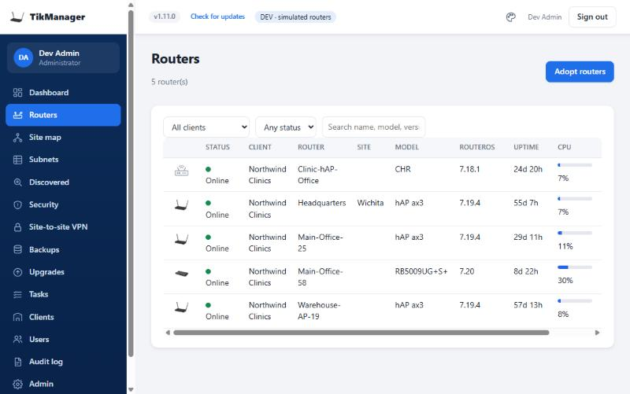
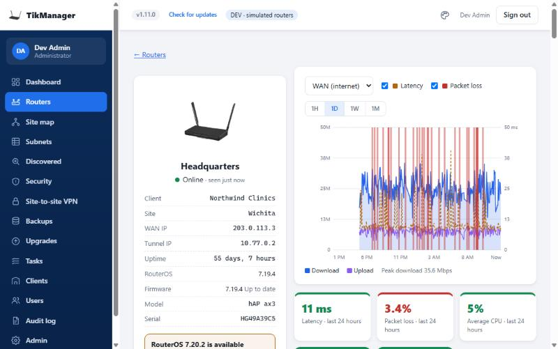
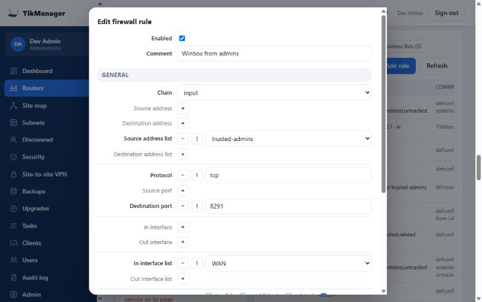
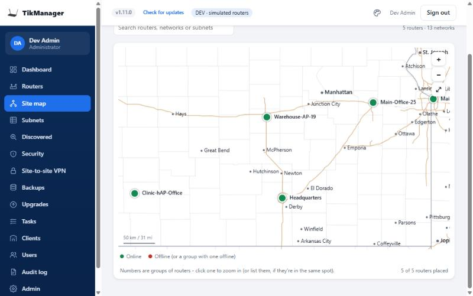
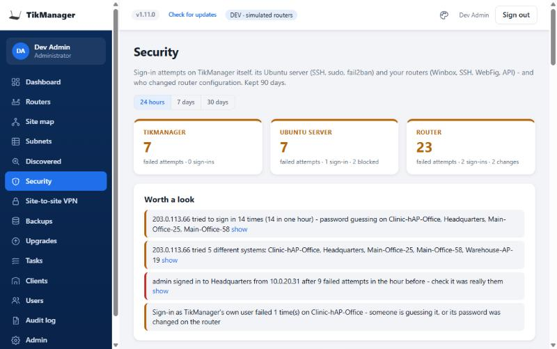

# TikManager

A self-hosted MikroTik RouterOS controller for MSPs and IT teams: adopt routers with one command, monitor them, back up
their configuration nightly, upgrade firmware on a schedule, push scripts, build site-to-site VPNs, and give each client
a read-only view of their own routers. It installs on an Ubuntu server with one command and updates itself from the web
page with one click.

Python 3 standard library only on the server (plus Ubuntu's `python3-cryptography` for encrypting stored configs),
SQLite, WireGuard and Caddy. No build step, no package manager.

| Every router at a glance | One router: health, traffic, upgrades |
|---|---|
|  |  |
| **Firewall rules, edited like WebFig - with automatic undo** | **Where every router is** |
|  |  |
| **Sign-in attempts on TikManager, its server and every router** | |
|  | |

*(Screenshots from dev mode with simulated routers.)*

MIT licensed - see [LICENSE](LICENSE). Found a security problem? Please report it privately: [SECURITY.md](SECURITY.md).

- [Install on a server](#install-on-a-server-ubuntu-2604-lts) · [First run](#first-run) ·
  [Microsoft sign-in](#microsoft-sign-in-for-your-technicians) · [What is configured where](#what-is-configured-where)
- [Updating TikManager](#updating-tikmanager) - what changed in each version: [CHANGELOG.md](CHANGELOG.md)
- Using it: [Routers](#routers) · [Maps](#maps-where-routers-are-and-whats-behind-them) · [WireGuard port](#changing-the-wireguard-port) · [Winbox](#winbox-through-tikmanager) · [Firewall & NAT](#firewall--nat-rules) · [Subnets in use](#subnets-in-use) · [Discovered](#discovered-mikrotiks-not-in-tikmanager-yet) · [Security](#security-sign-in-attempts-everywhere) · [Alerts](#alerts-connectwise-tickets-and-teams) · [Clients and their users](#clients-and-their-users) ·
  [Configuration backups](#configuration-backups) · [Router upgrades](#router-upgrades-routeros-and-firmware) ·
  [Site-to-site VPN](#site-to-site-vpn) · [Remote access](#remote-access-wireguard-for-windows) · [Performance & security](#performance--security-dashboard) · [Compliance](#compliance) · [Tasks](#tasks-scripts-groups-schedules-automatic-firmware-updates) ·
  [Integrations](#integrations) · [Admin](#admin)
- Running it: [Keeping it secure](#keeping-it-secure) · [Where things live](#where-things-live-on-the-server) ·
  [Troubleshooting adoption](#if-a-router-registers-but-never-comes-online)
- Design and security model: [ARCHITECTURE.md](ARCHITECTURE.md). Changing the code (with or without an AI assistant):
  [CLAUDE.md](CLAUDE.md). Try it without routers: [dev mode](#try-it-locally-dev-mode-simulated-routers).

## Install on a server (Ubuntu 26.04 LTS)

Before you start:
- a VM, ideally in a DMZ that can't reach your LAN (routers connect to it from the internet);
- a DNS name for it (e.g. `tikmanager.example.com`) pointing at your public IP;
- your firewall forwarding **443/tcp** (and 80/tcp, which helps Let's Encrypt) and **51820/udp** to the VM;
- SSH access to the VM from your LAN.

On the server, download the installer and run it:

    curl -fsSL https://raw.githubusercontent.com/astukestarr/tikmanager/main/deploy/get.sh -o get.sh
    sudo bash get.sh --host tikmanager.example.com --lan 192.168.1.0/24

- `--host` is the public DNS name; `--lan` is the only subnet allowed to SSH to the server. Leave either out and it
  asks (it suggests the server's own subnet for `--lan`).
- It downloads the newest TikManager release from GitHub (`--version 1.2.0` picks one), checks it, and installs
  WireGuard, Caddy (HTTPS via Let's Encrypt), the firewall, fail2ban and the service.
- It **ends by printing a one-time setup link** - open it to create your administrator account ([First run](#first-run)).
- Prefer one line? `curl -fsSL <that URL> | sudo bash -s -- --host ... --lan ...` does the same; downloading first
  lets you read the script before running it as root.
- Running your own fork? Add `--repo yourname/tikmanager`: it installs from your repository, and your servers take
  their updates from it too.

From a Windows PC instead (copies this folder to the server over SSH; asks for the server user's password and sudo
password):

    powershell -ExecutionPolicy Bypass -File .\deploy\push.ps1 -VM youruser@VM-IP -Install -HostName tikmanager.example.com -Lan 192.168.1.0/24

(or copy the folder to the server yourself and run `sudo bash deploy/install.sh --host ... --lan ...`).

### First run

1. Open the setup link. Enter your company name, your name, email and a password (14+ characters) and the email
   domain(s) of your staff. That creates the first administrator; the link stops working afterwards.
2. Sign in with that email and password - you'll be asked to set up an authenticator app (required).
3. **Admin > Settings**: set up Microsoft sign-in for your technicians (below), check the staff domains and admins.
4. **Admin > Branding**: logo, colour, sign-in message, support contact shown to clients. Until you upload a logo,
   TikManager shows its own (the name, with the T drawn as a tiki torch).
5. **Clients**: add your clients (or import them from ConnectWise PSA on Admin > Integrations).
6. **Routers > Adopt routers**: copy the adoption command and paste it into a router's terminal (RouterOS 7), then
   approve the router and pick its client.

### Microsoft sign-in for your technicians

Entra admin center > App registrations > New registration:
- Name **TikManager**, *Accounts in this organizational directory only*.
- Redirect URI: platform **Web**, `https://<your TikManager name>/auth/callback` (Admin > Settings shows the exact value).
- Certificates & secrets > New client secret (copy the **Value**).
- No API permissions are needed beyond the default *User.Read*.

Enter the Directory (tenant) ID, Application (client) ID and secret on **Admin > Settings** - no restart needed.
- Anyone from your staff email domains becomes a technician at first sign-in; the administrator emails become admins.
- Only accounts from your own organization can sign in - guest accounts invited into your tenant are refused.
- Each technician is tied to their Microsoft account at first sign-in, so a renamed or reused email address doesn't
  inherit someone else's TikManager account. If you replace someone's Microsoft account, use **Reset sign-in** for
  them on Admin > Technicians.
- The first administrator's password account keeps working as a way in if Microsoft sign-in is ever broken.

### What is configured where

| Setting | Where |
|---|---|
| Company name, logo, colours, sign-in message, support contact | Admin > Branding |
| Staff email domains, administrators, Microsoft sign-in, WireGuard address, latency test target | Admin > Settings |
| Backup time and versions kept | Admin > Settings |
| ConnectWise PSA, IT Glue | Admin > Integrations |
| Public address, data folder, port, controller WireGuard key, where updates come from | `/etc/tikmanager/tikmanager.env`, written by the installer (see `.env.example`) |

Settings saved on the web pages override the settings file; secrets entered there are stored encrypted with a key
derived from the server's master key and are never shown again.

## Updating TikManager

Versions are numbered `MAJOR.MINOR.PATCH` ([semantic versioning](https://semver.org)): a **patch** (1.2.**1**) only
fixes things, a **minor** version (1.**3**.0) adds features, and both are safe to install with the button. A **major**
version (**2**.0.0) needs something from you, and [CHANGELOG.md](CHANGELOG.md) says what. Your data, settings, keys and
routers are kept by every upgrade.

**Which version am I on?** Next to the logo at the top of every page ("v1.4.0"), and on **Admin > Settings > Version
& updates**, which also shows the newest release, when TikManager last checked and where updates come from.

**How do I know there's a new one?** Every hour TikManager asks GitHub for the newest release. When there is one,
administrators see a **banner across the top of every page** - "TikManager X is available. You're on Y." - with What's
new and **Upgrade now** (x hides it for a day; a newer release shows it again). Open pages pick it up within 5 minutes,
and show progress while an upgrade runs. **Check for updates** next to the version number at the top (or on the
Version & updates card) checks immediately.

**Upgrading with one click** (administrators):
1. Click the **Update available** badge (or go to Admin > Settings). **What's new** opens that version's notes.
2. Click **Upgrade now**, then click again to confirm.
3. The card shows progress. The server downloads the release from GitHub, checks it, backs up the current code
   (`/opt/tikmanager.prev`) and the database (`/var/backups/tikmanager/backup-before-<version>.db`, root only; the last
   3 are kept), installs it and restarts TikManager. That takes about a minute; the page says "Restarting..." and
   reloads by itself on the new version.
4. If the new version doesn't start, the server puts the previous version back automatically and the card says
   "Last upgrade failed" with the reason. Routers are not touched by an upgrade, so monitoring carries on either way.

**Stable or beta** (Admin > Settings > Version & updates > Channel): **Stable** (the default) gets releases once they've
been tested. **Beta** gets new features and fixes first (versions like 1.45.0-beta.2), which may have rough edges. Only the
newest beta is ever offered - a beta that a later beta fixes is never installed again - and a version listed as withdrawn
in the repository's RELEASES.json is never offered or installed. Switching back to Stable keeps the version you have until
the next stable release, which is then offered as usual.

**Upgrading from a terminal** (same steps, same safety net), on the server:

    sudo bash /opt/tikmanager/deploy/self-update.sh            # newest stable release
    sudo bash /opt/tikmanager/deploy/self-update.sh beta       # newest release, betas included
    sudo bash /opt/tikmanager/deploy/self-update.sh 1.2.0      # a specific version
    journalctl -u tikmanager-update                            # what the last upgrade did

The updater never installs an older version than the one you have - from the button it can't, and by hand only if you
insist: `sudo TM_ALLOW_DOWNGRADE=1 bash /opt/tikmanager/deploy/self-update.sh 1.0.0`. To undo the last upgrade, the
steps below are simpler.

**Servers installed before 1.0.0** don't have the updater yet. Install it once by copying the current code over from a
Windows PC, after which the button works:

    powershell -ExecutionPolicy Bypass -File .\deploy\push.ps1 -VM youruser@VM-IP

(or copy the folder to the server and run `sudo bash deploy/update.sh`). The same command is how you deploy code you've
changed yourself without publishing a release.

**Coming from 1.1.0 or older:** from 1.1.1 on, pre-upgrade database copies are kept in `/var/backups/tikmanager/`. Old
copies in the previous place can be deleted:
`sudo rm -f /var/lib/tikmanager/backup-before-*.db /var/lib/tikmanager/update-status.json`

**Going back to the previous version by hand** (rarely needed - a failed upgrade rolls back by itself):

    sudo rsync -a --delete /opt/tikmanager.prev/ /opt/tikmanager/ && sudo systemctl restart tikmanager

If you also need the database as it was before the upgrade (newer versions only *add* to the database, so the previous
version normally runs fine on it):

    sudo systemctl stop tikmanager
    sudo cp /var/backups/tikmanager/backup-before-<version>.db /var/lib/tikmanager/tikmanager.db
    sudo rm -f /var/lib/tikmanager/tikmanager.db-wal /var/lib/tikmanager/tikmanager.db-shm
    sudo chown tikmanager:tikmanager /var/lib/tikmanager/tikmanager.db && sudo systemctl start tikmanager

Anything recorded since the upgrade (new backups, metrics, events) is lost when you restore the database.

**Where updates come from** is `TM_UPDATE_REPO` in `/etc/tikmanager/tikmanager.env` (default the public
`astukestarr/tikmanager` repository). It can only be changed in that root-owned file, never on the web pages, so a
stolen administrator account can't make the server install someone else's code. Running your own modified copy? Fork
the repository, point `TM_UPDATE_REPO` at your fork (or install with `get.sh --repo`) and publish your own `vX.Y.Z`
tags (see [CLAUDE.md](CLAUDE.md#releasing-a-new-version)). `TM_UPDATE_CHECK=0` turns off the hourly check (the button
still works).

## Devices (routers, switches, access points)

The sidebar's **Devices** group lists All devices, Access points, Routers and Switches - the kind comes from the
model and can be changed per device (Settings tab > Tags, notes & type).

**Routers** lists every approved router with its status, client, site, model, RouterOS version, uptime, CPU and when it
was last seen, and its **age**. Filter by client, status (including **Discontinued model** and **5+ years old**) or text; click a column header to sort by it (click again to reverse - Status
puts offline routers first). Routers that registered but aren't approved yet are listed above, under **Waiting for
approval**. Click a router for its page: charts, interfaces, DHCP clients, backups, upgrades, scripts and events.

**Internet links:** each router's ISP / WAN / LTE links (found from interface comments like "ISP1" or "Backup WAN",
or picked on the router's Settings tab) are shown with their state, address and which one carries the traffic; events
and an alert when one goes down, comes back or changes address.

**Hardware health:** each router's page graphs its sensors (temperatures, voltage, fans, power) and fibre modules'
light levels every 5 minutes for 30 days; alerts can fire when a router runs hot or out of memory.

**Auto-block:** addresses that keep failing to sign in to your routers (counted across the fleet) can be listed
(audit) or blocked on every router automatically, via the `tikmanager-blocklist` address list with a RouterOS timeout.
Each router needs one rule that drops the list - TikManager adds it to routers that lack it whenever something is blocked
(Auto-block > Settings can turn that off); **without it the address is only listed, not dropped**; the Security
page says so at the top, shows "dropped on N of M" per blocked address, and adds the rule (one router, or all). A block
stops connections from that address straight to a router; Winbox through TikManager's relay comes from TikManager's own
address and isn't affected. **Unblock** (Top addresses, or Auto-block > Blocked now) releases it at once and takes it off
the routers in the background. Non-public addresses, TikManager, your routers and a whitelist are never blocked. Off
until an administrator turns it on.

**Region blocking:** per client, Block or Allow only a list of countries - Incoming, Outgoing or Both - on its routers,
with per-router exceptions (leave a router out, or let some countries through on it). Country data is IPinfo Lite (free
token; downloaded daily by TikManager, never by routers). The `tikmanager-geo` address list lives in router RAM only and is
loaded in small batches with a CPU watchdog; routers without the memory for it are skipped; a startup scheduler keeps the
rules off after a reboot until the list is back. TikManager, your routers and addresses your people actually used are
never blocked. IP address data powered by [IPinfo](https://ipinfo.io).

**Flows (pilot):** router page > Flows lists conversations through a router - client, destination, country, organisation,
service, download / upload - with filters, CSV and what region blocking dropped. Opt-in per router (128 MB+): RouterOS
Traffic Flow (IPFIX) to TikManager over the tunnel (UDP 2055), 10-minute summaries kept 7 days. On routers with FastTrack
the byte counts are low (FastTracked packets skip Traffic Flow).

**RouterOS security:** each router's page says whether MikroTik has released a security fix newer than its RouterOS
on its channel (read from MikroTik's changelogs) and lists known CVEs for its version (NIST's vulnerability database,
daily); the Upgrades page badges them, the Security page lists the fleet, and an alert can open a ticket. **What's new**
shows MikroTik's release notes for a version, security lines first, before you upgrade.

**Routing tab** (router page): BGP, OSPF (neighbors and their state), RIP and the route table (active routes by protocol,
default routes), read live with Refresh.

**BGP:** on routers running BGP (an enabled instance on RouterOS 7.20+, or configured connections on older 7.x), every
BGP connection is checked each minute against its session: a BGP card on the router's Overview, events when a peer drops
or comes back, a **BGP peer down** alert and a finding on Performance & security. Listening ranges (dynamic peers) are
left out.

**Flagged routers:** RouterOS 7.13+ flags itself when it finds signs of unauthorized access in its configuration
(device-mode); MikroTik says to treat such a router as compromised. TikManager reads the flag hourly and shows it on the
router's page (with what to do), in the routers list and on the Dashboard, and raises an alert.

**Wireless** (tab on routers with radios - legacy wireless, wifi or 60 GHz): each radio's settings and, read live every
10 seconds, either the **point-to-point link** (signal at both ends, SNR, CCQ, rates, distance, link uptime, the other
end) or, for an **access point**, its **clients** (signal, SNR, CCQ, rates, connected time, traffic; weakest first,
searchable) - handy for an office AP or an ISP sector full of CPEs.

**Lifecycle - how old, and still sold?** Each router's page shows when it was **made** and whether MikroTik has
**discontinued** the model; the Dashboard lists discontinued and 5+-year-old routers, oldest first, so replacements can
be planned (clients see their own). Both come from MikroTik: the age from the router's factory firmware (the RouterOS
version it shipped with, dated by MikroTik's changelog - accurate to a few months), "discontinued" from the model's
mikrotik.com product page (checked weekly). MikroTik publishes no end-of-support dates - a discontinued model still gets
RouterOS updates for now. Each discontinued or old router also gets a **suggested replacement** - a current MikroTik
model of the same kind (from a short list per old family, shown only while MikroTik still sells it). Administrators can
set their own standard model per router model on Admin > Settings > **Replacement suggestions**.

**Adding routers:** **Adopt routers** shows the adoption command (the same for every router). Paste it into the
router's terminal (Winbox > New Terminal, or SSH); the router registers itself, then a technician approves it and picks
its client. It needs RouterOS 7 (it copes with settings that newer 7.x versions renamed) and is safe to run again on a
router that's already adopted - for example after a failed attempt. On the router it creates a WireGuard interface
`tikmanager` (the private key never leaves the router), a `tikmanager` user that may only log in from TikManager, a
firewall rule letting TikManager in through the tunnel, web (REST) access for TikManager and log forwarding.

**Ports** (router page tab, technicians): a UniFi-style port diagram (speed, PoE, uplink, connected devices), VLAN
grids (native / tagged / blocked per VLAN) or a port table, and VLAN management - native and tagged VLANs per port,
add / rename / delete VLANs, VLAN filtering - with the commands shown first and an automatic undo unless you press
Keep within 5 minutes. TikManager's own management port and VLAN are protected.

**Logs** (technicians): every router log line (info and up), live, searchable by router / client / tag / severity /
topic / text, exportable as CSV, kept 14 days; each router also has a Logs tab. **Alert rules** turn a matching line
(N times in M minutes) into an alert.

**Tags and notes** (router page > Settings): tag routers (*core*, *poe-switch* ...) to filter the Routers page and to
target Tasks by tag; notes (technicians only) hold rack positions, ISP contracts and the like, and are searchable.

**Changing a router** (bottom of its page, **Manage**): set its identity on the router, its name and site in
TikManager, or move it to another client (its backups and history move with it).

**Removing a router:** its page > **Manage** > **Remove router** (click twice). TikManager forgets it and closes its
tunnel; if it's in a site-to-site VPN, take it out of the VPN first. What the adoption command created stays on the
router - to remove that too, paste this into the router's terminal:

    /system logging remove [find action=tikmanager]
    /system logging action remove [find name=tikmanager]
    /ip firewall filter remove [find comment="TikManager"]
    /user remove [find name=tikmanager]
    /user group remove [find name=tikmanager]
    /ip address remove [find comment="TikManager"]
    /interface wireguard remove [find name=tikmanager]

and remove `10.77.0.1/32` from IP > Services > www (*Available From*) if it was added there.

## Maps: where routers are, and what's behind them

**Site map > Map** shows every router where it is. Zoom from the whole country down to town level: state borders,
county lines, interstates and the name of every incorporated US city and town appear as you zoom in (wheel, pinch,
double-click or +/-; drag to pan). Routers close together show as a numbered group - click it to zoom in; red means at
least one is offline. Click a router to open it. The map is drawn by TikManager from built-in public-domain data
(Natural Earth and the US Census Bureau), so nothing is loaded from other sites.

**A router's location** is set on its page (**Location > Set location**): type an address, press **Look up** (optional
- only the text you type is sent to OpenStreetMap's address search), type the coordinates, or click the spot on the
map. Routers with a GPS receiver place themselves; a location set by hand always wins. Routers without one are listed
under the map, and so are routers set to exactly the same spot (on the map, clicking such a group lists its routers).

**Network map** (each router's page): Internet and its gateway -> the router -> each network / VLAN -> the switches and
access points found by neighbour discovery (MNDP / LLDP / CDP), each with the devices on its port -> groups of devices:
phones, printers, servers & VMs, cameras, computers, personal devices, IoT and unidentified. Click a group to list its
devices (name, IP, MAC, port). Routes to other networks (VPN, static, dynamic) are listed for technicians; client users
see their networks but not the routing table. Infrastructure and routes come straight from the router; end devices are
recognised by their maker and name, so some stay "Unidentified" (unlike a scanner, the router doesn't probe them).

## Changing the WireGuard port

Routers connect to TikManager on **UDP 51820** unless you pick another port at install (`--wg-port`). To change it
later - e.g. a network that blocks 51820 - use **Admin > Settings > WireGuard port** (or **Use UDP 443**, the port most
likely to get through restrictive networks):
1. Forward the new UDP port to the server on your edge firewall, keeping the old one forwarded for now.
2. Press **Move**. The server switches ports; TikManager relays the old port to the new one so nobody drops off, and
   switches every router's tunnel to the new port (offline routers when they reconnect).
3. When the card shows every router moved, press **Close old port**, then remove the old forward on your edge firewall.

## Winbox through TikManager

**Router page > Winbox > Open Winbox** (technicians) gives you an address like
`tikmanager.example.com:40012` to type into Winbox's **Connect To**, and a login made just for that session. TikManager relays
that port to the router's Winbox over the router's tunnel, so Winbox is never open on the router's internet side and
routers without a public address work too.

- Only your public address can use the session (change it if your Winbox goes out through a VPN); anything else is
  disconnected and shows on the Security page.
- 30 minutes, **Extend** for 30 more (up to 4 hours), closed after 10 minutes without traffic or with **Close**.
- **Your own login for the session**: TikManager creates a temporary router user just for you (e.g. `alan.tm`, random
  password - hidden on the page, with Copy and Show - only for you) in the router's **full** group - or **read** if you're a read-only technician in TikManager -
  that can only sign in through TikManager, and deletes it when the session ends. The router's log then says
  "changed by alan.tm".
- **What you changed**: a configuration backup is taken when the session ends (labelled with the session and you), so
  **What changed** shows exactly what it did; the Security page labels the router's log lines with your name.
- If the router's Winbox is turned off or limited to certain addresses, the box offers a one-click fix (write access)
  that lets only TikManager's tunnel address in.
- **Setup:** forward **TCP 40000-40049** to the TikManager server on your edge firewall (the installer / upgrade opens
  it in ufw). `TM_WINBOX_PORTS` changes the range - change the ufw rule and your edge firewall to match.

## Firewall & NAT rules

Each router's page has a **Firewall & NAT** card (technicians): the filter and NAT rules in order, with what each matches
and how much traffic it has seen; pick a chain to narrow the list. Technicians with write access can **add**, **edit**,
**enable / disable**, **delete** and move rules **up / down**. The rule editor is laid out like WebFig: add a match field
with **+**, remove it with **-**, tick **!** for "not"; interfaces, interface lists and address lists are picked from the router's own.

Changes are tested first, like **Safe Mode** in Winbox (Safe Mode itself only exists inside a Winbox / terminal
session, which the REST API TikManager uses doesn't have, so TikManager does the same thing with a router script):
1. Before the first change, TikManager backs up the router (unless it was backed up in the last 10 minutes), saves a
   script on the router that restores the filter and NAT rules exactly as they are, and a scheduler that runs it in
   5 minutes (`tikmanager-fw-undo` in System > Scripts / Scheduler).
2. It makes the change and checks it can still reach the router. Each further change restarts the 5 minutes.
3. Check the site still works, then press **Keep changes** (the script and scheduler are removed) - or **Undo now**.
   If nobody keeps the changes in time, or a change cut TikManager off, the router puts the rules back by itself.

TikManager's own rules (comment starting "TikManager": its management rule and the site-to-site VPN rules) and dynamic
rules are locked. Only the common fields can be set (addresses, ports, protocol, interfaces and lists - address lists are picked from the router's own -, connection
state, NAT targets, jump / reject / address-list options, log, comment); other settings a rule already has are left
alone. Each change, keep and undo is in the audit log and the router's events. Very large rule sets (where the
restore script would be over 60 KB) are refused - change those in Winbox with Safe Mode.

**Address lists** (third tab): pick a list, search it, and add, edit, enable / disable or remove addresses - **Add
address** can also start a new list. Entries a rule added by itself (dynamic, with a timeout) can be removed but not
edited. These changes are tested the same way: the undo script re-adds what was removed, removes what was added and
sets edited entries back.

## Community script library

**Tasks > Scripts > Community library** lists RouterOS scripts shared in a public GitHub repository - by default
[astukestarr/routeros-scripts](https://github.com/astukestarr/routeros-scripts) (Admin > Integrations > GitHub). Open
one to read it in full - lines that deserve a second look (resets, users, file deletion, downloads, schedulers,
services, firewall removals, updates, TikManager's own access) are highlighted - and import it into your own scripts.
Nothing runs until you run it.

**Share** next to one of your scripts sends it to the library as a pull request for its owner to review. TikManager
first checks it for passwords, keys, public IP addresses, e-mail addresses and client names, and each finding must be
removed or confirmed. Sharing needs a GitHub token (classic, only the `public_repo` scope) on Admin > Integrations.

## Subnets in use

**Subnets** lists every LAN subnet on every approved router, grouped by client: subnet, name (the interface comment),
router, interface, gateway address and usable addresses. It's read from the routers each time they're polled, so it
stays current without anyone keeping a spreadsheet.
- **Overlaps** between a client's own subnets are flagged and tinted - two sites using the same range can't be joined
  with a site-to-site VPN without renumbering one. **Only overlaps** shows just those.
- The **MikroTik default** (192.168.88.0/24) is marked, and so are ranges **also used at other clients** (fine on their
  own; worth knowing before connecting two networks).
- Search by subnet, name, router or client - or type an IP address to find the subnet it belongs to.
- **Export CSV** downloads what's shown. Client users see only their own subnets.

## Discovered: MikroTiks not in TikManager yet

**Discovered** (technicians) lists the MikroTik devices your routers see next to them in **IP > Neighbors** (MNDP / LLDP /
CDP) that aren't in TikManager: identity, model, RouterOS version (v6 is flagged - TikManager needs RouterOS 7), IP and
MAC, which router saw it on which port, and its uptime. Each router's neighbours are read every 15 minutes. A device
counts as already in TikManager when one of its MACs, its IP or its identity matches a router TikManager has (or is
waiting to approve) - except the factory identity "MikroTik". Routers only see devices on their own networks that have
discovery turned on (IP > Neighbors > Discovery Settings). **Adopt routers** on the page gives you the command to run.

## Alerts: ConnectWise tickets, Teams and email

**Alerts** (technicians; administrators change the settings) - when something's wrong, TikManager opens a
**ConnectWise ticket**, posts to **Teams** and / or sends an **email**, and closes the ticket / posts "resolved" when it clears:
- **What**: a router offline for N minutes (not during an upgrade), an unexpected restart, an internet link down N minutes, a router RouterOS flagged as possibly compromised, a failed backup, Security-page warnings, a FAIL
  from the server security check, the website grade dropping below A; optionally high CPU, high memory, a router running hot and new RouterOS versions.
- **ConnectWise**: tickets go to the client's linked company (Clients page) or a default company you choose; pick the
  board, the status for new tickets, the status when it clears (or leave it open with a note) and the priority. The
  API member needs Service Desk > Service Tickets: Add, Edit and Inquire.
- **Teams**: in the channel, **...** > **Workflows** > **Post to a channel when a webhook request is received**; paste
  the URL it gives you. It's stored encrypted like the other integration keys.
- When more than 5 routers drop in the same minute you get one grouped alert, not a ticket each.
- **Email**: set up email first (Integrations, below), then list the addresses (comma-separated).
- **Webhooks**: Slack, Discord, ntfy (phone push), TikManager JSON or a custom HTTPS endpoint (method, headers, body
  template with {{placeholders}}); optional HMAC signing; each can be limited to some kinds of alert.
- **Send a test ticket** / **Send a test to Teams** / **Send a test email** / **Test** (webhooks) check the setup.

## Security: sign-in attempts everywhere

**Security** (technicians) shows every attempt to sign in to TikManager, its Ubuntu server and your routers, and who
changed router configuration:
- **TikManager**: failed passwords and MFA codes, failed Microsoft sign-ins, lock-outs, addresses refused for too many
  attempts, wrong adoption commands, and successful sign-ins.
- **Ubuntu server**: SSH sign-ins, sudo password failures and fail2ban blocks - read every 5 minutes by
  `tikmanager-authlog.timer` (root, read-only: the web app can't read the system journal itself). An address fail2ban
  has banned right now shows "blocked: server SSH" (it guards SSH to the server only) with **Unblock**, done by
  `tikmanager-unban.path` / `deploy/f2b-unban.sh` (root; it accepts only "unban <IP address>").
- **Routers**: login failures and logins (Winbox, SSH, WebFig, API) and "changed by" lines from the log each router sends
  TikManager over its tunnel (set up at adoption; received on the tunnel address only). TikManager's own routine
  REST logins are left out.

It totals them for 24 hours, 7 days or 30 days, lists the top addresses trying to get in, and flags what's worth a look:
password guessing, one address trying several systems, a success right after failures (check it was really them), and
TikManager's own router login failing (someone guessing it, or its password changed). Events are kept 90 days.

## Clients and their users

**Clients** are your customers; every router belongs to one. Add them by hand or import them from ConnectWise PSA.

Each client can have its own users (**Users > Invite**): they get an invitation link, choose a password (14+
characters) and must set up an authenticator app. **Client admins** can invite and manage their organization's users;
**viewers** can only look. Client users see only their own routers - status, charts, interfaces, DHCP clients, events
and that backups exist - never configurations, secrets, scripts or other clients. Technicians can disable users, send
a new invitation link, or reset someone's authenticator app.

**Winbox and site-to-site VPNs for client admins** (off by default): on **Clients**, an administrator can give a
client's admins **Winbox** to their own routers - *read-only* or *full* router login, through the same address-locked,
30-minute relay technicians use - and/or let them create and change **site-to-site VPNs** between their own routers.
Viewers never get either; client admins can't change a router's Winbox service (a technician turns it on for
TikManager). Every session and change is audit-logged, and turning Winbox off closes that client's open sessions.

**View as** (administrators): on **Users**, *View as* next to a client user shows TikManager exactly as that person sees
it - their menu, routers, pages and buttons - to check what they can reach. It's look-only: every change is refused
until you click **Stop viewing** in the purple banner, and starting / stopping is audit-logged.

Sign-in is protected: after 5 wrong passwords or codes an account is locked for 15 minutes, three wrong authenticator
codes end the sign-in attempt, and every sign-in is in the audit log.

## Configuration backups

Each export is checked for completeness before it's stored. The Backups page shows coverage (backed up / overdue /
failed / none), **Download all (zip)** gets every router's newest configuration at once, and Admin > Settings can keep
a plain-text copy of each latest configuration in `<data>/exports` (off by default; make it a git repository for a
change history).

Every approved router is exported nightly (Admin > Settings sets the hour; default 02:00 server time) over its tunnel as
a **script** (`/export show-sensitive`) - import it with `/import` on any RouterOS 7 router, including a different
model (adjust interface names as needed). A new version is stored only when the configuration changes, and each router
keeps its newest 10 versions (Admin > Settings; the oldest is removed when a new one is saved). Each is compressed and
encrypted with AES-256-GCM using a key derived from the master key, so the database alone reveals no router passwords.
Only technicians can view, compare ("What changed") or download versions; every view and download is audit-logged.

## Router upgrades (RouterOS and firmware)

When upgrading several routers: a **safety stop** holds the rest after N failures (resume or cancel them on the
Upgrades page), **one at a time** runs them strictly in the order you set, and **only the version shown now** skips a
release MikroTik publishes between scheduling and running.

(For upgrading TikManager itself, see [Updating TikManager](#updating-tikmanager).)

**Upgrades** (technicians) lists every router's RouterOS version, the newest on its update channel (each router asks
MikroTik's server twice a day, or on **Check for updates**) and its RouterBOARD firmware. Upgrade one router from its
page, or tick several and **Upgrade selected**: now or at a scheduled time, on the router's own channel or stable /
long-term, optionally with the RouterBOARD firmware, and optionally staggered (N minutes between routers; at most 4
upgrade at once). Each job backs the router up first and stops if that fails, downloads the new RouterOS, reboots,
waits up to 15 minutes for the new version, then stages the matching firmware and reboots once more. Scheduled jobs can
be cancelled until they start; every step is shown on the router's page, in its events and in the audit log.

## Site-to-site VPN

> **Turned off for now (1.45.1):** VPNs built and managed by TikManager are switched off until they've been tested
> further - the page shows only **Existing VPNs on routers**, and tunnels TikManager already built keep running and show
> there read-only. `TM_MANAGED_VPN=1` in `/etc/tikmanager/tikmanager.env` (then restart the service) turns it on for testing.

**Site-to-site VPN** (technicians) connects a client's routers with WireGuard, hub and spoke. Pick the client, tick its
routers, choose the hub and the subnets each site shares (pre-filled from the site map, guest networks unticked), then
**Save and apply**. The hub needs a public address: its WAN IP is used automatically; if it sits behind NAT, enter its
public IP or DDNS name and forward the UDP port (default 13232) to it. Spokes can be behind NAT/CGNAT.

Before anything changes: overlapping subnets (and clashes with the tunnel network or TikManager's 10.77.0.0/16) are
refused, every router must be online and on RouterOS 7, and each is backed up. The routers create their own keys
(private keys never leave them). Each gets an interface `tikmanager-vpn`, an address on the tunnel network
(10.250.x.0/24 unless you set one; hub = .1), peers, routes to the other sites' subnets and accept rules at the top of
its firewall (hub: the UDP port; all: ICMP from the tunnel, forwarding to/from it) - all commented `TikManager VPN`.
Apply again replaces exactly those objects; **Disable**, **Delete** or unticking a router removes them and the
interface. Spoke-to-spoke traffic goes through the hub. Tunnel status (handshake age, ping to the hub, traffic) is
checked every minute and shown on the VPN, the router page and the site map. If a site masquerades *all* outgoing
traffic (a srcnat rule without an out-interface), restrict that rule to the WAN so site-to-site traffic isn't NATed.

**Existing VPNs on routers** (second tab) lists VPNs configured outside TikManager - WireGuard peers, IPsec peers with
their policies, L2TP/SSTP/OpenVPN/PPTP clients and servers (with who is connected), EoIP/GRE/IPIP tunnels - read every
15 minutes or on demand, read-only. Only names, addresses, subnets, status and traffic are read (a field whitelist: no
passwords, pre-shared keys or private keys). A remote end that is another TikManager router's WAN/public IP is shown as
that router; PPTP and IPsec without phase 2 are flagged. The same list appears on each router's page. Client admins
with site-to-site VPNs turned on see this tab too, for their own routers only (remote ends are matched only against
their own routers, so other clients' routers are never named).

**Restart tunnel**: each existing VPN that is switched on has a **Restart tunnel** button (and each site of a TikManager VPN on
its page) - for a tunnel that's stuck; click it twice to confirm. The Site-to-site VPN page refreshes every 30 seconds, and
**Read routers again** fills the list in as the routers answer. IPsec drops its active peer so it renegotiates; WireGuard peers, L2TP / SSTP /
OpenVPN / PPTP clients and EoIP / GRE / IPIP tunnels are switched off and straight back on (TikManager VPNs: their
WireGuard peers) - by the router itself, in one short script, so it comes back on even when the tunnel being switched off
is the one TikManager's connection runs over. Only a tunnel found in that router's inventory can be reconnected (never TikManager's own management
tunnel, never anything else), by technicians with write access or client admins with site-to-site VPNs turned on, for
their own routers. Every reconnect is audit-logged and recorded in the router's events.

## UniFi and UISP

TikManager can show your Ubiquiti networks next to the MikroTiks: **Admin > Integrations > UniFi & UISP** holds any number
of **connections**, each one of:
- **UniFi** - an API key from **unifi.ui.com > Settings > API** (Ubiquiti's Site Manager API: read-only, it can't change
  UniFi settings), created while signed in as the account that owns or is super admin of the consoles.
- **UISP** - the UISP server's address (`https://your-uisp-server`) and an API token from **UISP > Settings > Users > API
  tokens** (a read-only token is enough). The server must be reachable on the internet - addresses on localhost, a private
  LAN or link-local are refused. A UISP server with a self-signed certificate can be trusted with **Trust this
  server's certificate**: TikManager records its SHA-256 fingerprint and refuses the connection if it ever changes
  (verification is never simply switched off).

Each connection either belongs to **your MSP account** - its sites are matched to clients automatically, first by
**public IP** (a site whose public address is the WAN / public IP of one of a client's routers belongs to that client;
UniFi: the site's WAN address, or the console's - also for a console at the customer running several of their sites, such
as a Cloud Key with no UniFi gateway, but never a hosted network server's; UISP: the public address of a device at the
site), then by name - or to **one client** (their own UniFi account or UISP server): everything in it belongs to that
client. On **Devices > UniFi / UISP** each site shows its public IP and why it has its client; choosing a client by hand
sticks (syncs never change it) until you pick **Match automatically** again. Connections are read every 10 minutes (or **Sync now**); keys and
tokens are stored encrypted and never shown again.

**Devices > UniFi / UISP** lists every site with its client, source, devices, offline devices (and since when),
firmware updates waiting and, for UniFi, client counts, WAN uptime, ISP and internet issues; click a site for its
devices (model, IP, status, firmware and the update available). Client users see their own sites there (read-only).
UISP subscriber locations (endpoints) are marked as such. A UniFi console that runs several sites (a self-hosted or Cloud
Key network server) doesn't tell the cloud API which site each device is on: TikManager asks the console through
Ubiquiti's cloud connector where it can and matches gateways by MAC; devices it still can't place are listed for
technicians only. On a router's **network map**, UniFi / UISP devices the router sees are badged **UniFi** / **UISP** (matched
by MAC: name, model, status, firmware update and site) - including devices that are only in the router's bridge host table
(no IP, e.g. on a management VLAN), placed at their port - and other Ubiquiti gear **Ubiquiti**. When a UniFi / UISP
switch is behind a router port, it's shown as that port's switch and everything behind the port hangs under it; every
device in the router's bridge host table is shown (not only those with an IP in ARP / DHCP). Only devices at that
router's location (in its tables) are shown, not the client's other locations. Alerts: **UniFi / UISP site has offline devices** (Alerts > Settings) - one alert per site, after 10
minutes by default.

## Performance & security dashboard

**Monitoring > Performance & security** (technicians) checks every router and lists what needs fixing, worst first, each
with how to fix it. Tiles per category (click one to filter); filter by severity, client or text. It refreshes every
minute and uses what TikManager already reads - nothing extra is polled. Findings that come down to one setting
(SSH strong crypto, Telnet / FTP / plain-text API on, SOCKS, web proxy, UPnP, bandwidth test server, MAC Telnet on every
interface, NTP off) have a **Fix** button and a **Fix all** per kind: each router is backed up first, only that setting
is changed, and the router is re-read. The checks:

- **Internet** - router offline, an internet link down (running on the backup), unstable link (3+ drops in 24 h),
  packet loss or high latency to the internet over the last hour.
- **Performance** - CPU or memory high over the last hour, storage nearly full, flash bad blocks, temperatures of 75 °C
  and up, a restart in the last 24 hours.
- **Open ports & services** - management services (Telnet, FTP, WebFig, SSH, Winbox, API) reachable from the internet
  (no address restriction and no catch-all drop in the input chain, or an input rule accepting them from anywhere), no
  catch-all drop at all, plain-text services enabled, an open DNS resolver, SOCKS, web proxy, UPnP, the bandwidth test
  server, MAC Telnet on every interface, SNMP.
- **Weak encryption / old VPNs** - PPTP servers and clients, L2TP without IPsec, IPsec proposals or profiles with
  DES / 3DES / MD5 / SHA1 / modp1024, IPsec aggressive mode, weak OpenVPN ciphers, SSH without strong crypto.
- **VPN problems** - tunnels that are down (laptops dialling in aren't counted), IPsec without phase 2.
- **Updates & CVEs** - routers RouterOS itself flagged, known vulnerabilities, RouterOS and RouterBOOT updates,
  discontinued models.
- **Backups** - no configuration backup in 7 days. **Hygiene** - the default 'admin' user enabled, NTP off.

The service, firewall, DNS / UPnP / proxy, SSH, NTP, user-name and cipher settings come with the 15-minute VPN
inventory (a field whitelist: no passwords, keys or SNMP community names are read).

Findings that aren't a problem on a router can be **accepted** with a reason (see [Compliance](#compliance)).

## What's new tour

After an update, technicians see a short tour of everything since the last full release - one feature per slide with a
screenshot, Next / Back, and **Show me**. **Got it - don't show again** hides it until the next full release (a later
beta's new slides still show once); **What's new** in the top bar opens it any time. Admin > Settings > Version &
updates > **What's new in past releases** has the release notes of this release line and the 5 before it, and their
tours where they have one.

## Compliance

**Monitoring > Compliance** (technicians) scores the routers against the network-device controls of **CIS Controls v8**,
**NIST SP 800-171 Rev. 2 / CMMC Level 2**, **PCI DSS 4.0** and the **HIPAA Security Rule**, for all clients or one. No
framework has a MikroTik benchmark, so each control is mapped to the router settings an auditor would look at
(compliance.py): management reachable from the internet, deny-by-default input and forward firewall, encrypted
management (Telnet / FTP / API off, WebFig over HTTP limited to the management address), SSH strong crypto, VPN crypto,
the default admin account, RADIUS sign-in, MFA (always "needs review" - RouterOS has none built in), central logging,
NTP, unneeded services, SNMP v3, a login notice, firmware and CVEs, backups, and - for 800-171 - FIPS-validated
cryptography, which MikroTik can't provide (CUI needs a FIPS-validated VPN on top).

- **Client report (PDF)** opens a branded report (Admin > Branding: company name and logo) to print or save as PDF:
  score, scope - it is evidence for these controls, not a certification - per-router results, each control with its
  evidence, a remediation plan, and documented exceptions. **CSV for auditors** has every router x control x check.
- **Accept** a finding on a router when it isn't a problem there (e.g. FTP used to back up switches, port 21 blocked
  from the internet), with the reason. It leaves the Performance & security list and its one-click fixes and shows in
  compliance as **Met with exception**, with the reason, who and when. Per item: accepting FTP doesn't excuse Telnet.

TikManager manages routers over REST on the WebFig (www) service, inside its WireGuard tunnel. Unless that service is
limited to management addresses (/ip service set www address=...), "Management traffic is encrypted" isn't met - WebFig
answers plain HTTP on the LAN. **Never disable www while TikManager uses it** - switch the router to HTTPS first (router
page > Settings > Management connection, or Fix all on "TikManager manages this router over HTTP"), then **Turn off
WebFig over HTTP**. Use the one-click **Limit WebFig
(HTTP) to TikManager** on Performance & security (you can also allow the client's admin addresses; www-ssl and Winbox
aren't touched, and the router undoes it by itself if TikManager loses contact), or accept it with the reason.

### HTTPS management connection

TikManager talks to each router's REST API inside its WireGuard tunnel, over HTTP by default. **Switch to HTTPS**
(router Settings tab, or the one-click fix for many routers) backs the router up and readies www-ssl without disturbing
anyone using it: it keeps an existing certificate (makes a self-signed `tikmanager-https` one only if there's none),
keeps a port other than 443, and moves 443 to 8443 / 9443 / 10443 / 18443 only when SSTP or another service already
holds 443. It makes sure www-ssl isn't open to the world: TikManager's tunnel address only if the service was off, the
private ranges + TikManager if it was open to everyone, the existing "available from" list + TikManager otherwise. It
switches only after HTTPS answers; otherwise www-ssl is put back as it was. HTTP stays as a fallback (used only when
the HTTPS connection can't be opened, and recorded as an event) until you turn WebFig over HTTP off. The certificate
isn't verified - the router is already authenticated by its WireGuard key inside the tunnel, and client certificates
get renewed - its fingerprint at switch time is shown on the Settings tab.

## Remote access (WireGuard for Windows)

An SSTP replacement: people connect to a client's router with the free **WireGuard** app (Windows, macOS, phones) -
faster, more reliable on poor connections, no certificates. Technicians set it up per router on the router page >
**Remote access**:

1. Check the suggested settings: the **address people connect to** (best: the router's MikroTik **Cloud DNS** name,
   which follows its public IP - **Use Cloud DNS** fills it in and turns IP Cloud on if needed; or a public IP / your own
   DNS name; forward the UDP port to the router if it sits behind another firewall), the **UDP port**, an **address range**
   for the people connecting (picked so it doesn't overlap the router's networks), **DNS** (the office DNS server, plus
   the Windows domain, e.g. `192.168.1.10, corp.local` - the domain becomes the search domain and the RMM script pins it
   to the office DNS server, since on a split tunnel Windows otherwise asks the laptop's own DNS) and **what goes through the tunnel**: only the office networks you tick
   (recommended), or all traffic.
2. **Set up remote access**. TikManager backs the router up, then adds a WireGuard interface, its gateway address and
   firewall rules (the UDP port open, people let through to the networks, ping - and DNS when it points at the router)
   at the top of the firewall. Everything carries the comment "TikManager remote access", so **Remove remote access**
   takes off exactly that (after another backup).
3. **Add person** for each laptop - optionally with an **expiry date** (revoked automatically at the end of that day) and
   **what they may reach**: everything, or only some servers and services (e.g. one file server over SMB, one web app
   over HTTP). The router enforces it with one firewall rule per allowed destination and a final drop for the rest of
   the tunnel. TikManager makes the key pair, adds only that peer on the router (nobody else drops)
   and offers **one download** - either an **RMM install script** or the .conf file. The config holds the private key:
   TikManager keeps it encrypted only until it's downloaded (or 7 days) and then deletes it - don't email it. **Revoke** removes just
   that person; **Disable** switches them off for now (same config when enabled again).
4. On the laptop - best: run the **RMM install script** as SYSTEM from Syncro or any RMM. It installs WireGuard if
   missing (newest MSI from download.wireguard.com, signature checked), saves the config readable by SYSTEM /
   Administrators only, installs the tunnel as an always-on service and adds the DNS rule for the domain; the person
   never handles a file. By hand: install WireGuard, **Import tunnel(s) from file**, pick the .conf, **Activate**, then
   delete the .conf (without admin rights a one-time Windows setting is needed to switch tunnels on).

The tab shows each person's last handshake and traffic, read live from the router when you open it, and a **connection
log** - who connected, when, from which public IP, for how long and how much data (read every 2 minutes, kept 400 days,
**Export CSV** for auditors). Connections from an address the person never used, or their key used from two places
within minutes (a copied config), are flagged in the log and raise a **Remote access** alert. WireGuard has no second
factor: a lost laptop means **Revoke** for that person - the tab's warning box lists the rest (BitLocker, MFA on what's
behind the VPN, least access, expiry dates; not FIPS-validated, so not for NIST 800-171 / CMMC).

## Tasks (scripts, groups, schedules, automatic firmware updates)

**Tasks** (technicians): a **Scripts** library of RouterOS scripts (placeholders `{{identity}} {{name}} {{client}}
{{site}} {{wan_ip}} {{tunnel_ip}}` are filled per router), **Groups** of routers you pick, and **Scheduled tasks**: run
a script - or upgrade firmware - on all routers, clients, groups and/or individual routers, once (now or at a time),
daily, on chosen weekdays or every N hours, in the timezone of the person who set it. Script runs back each router up
first (on by default; a router is skipped if that fails), run via REST `execute` over the tunnel (8 at a time), and
keep each router's output in **History**. Offline routers are skipped, or run when they come back within 24 hours. A
firmware task gives every target router with a newer RouterOS (or RouterBOARD firmware) the Upgrades page's safe
upgrade and skips routers already up to date - e.g. "All routers, Sundays 02:00" keeps everything current. Each router
page also has **Run script...** for a one-off. Every change and run is audit-logged.

## Integrations

Admin > Integrations (administrators). Keys are typed on the page, stored encrypted (AES-256-GCM, derived from the
master key) and never shown again - the page only says a key is saved. The server needs outbound HTTPS to the PSA and
IT Glue.

- **ConnectWise PSA** - site, company ID, public/private key of an API member with a *read-only* security role, and
  your client ID from developer.connectwise.com. Lists companies (filter by type/status) so you can import them as
  clients or link existing clients; matching names are suggested.
- **IT Glue** - region and an API key (leave "Password access" off). Link each client to its IT Glue organization (name
  matches are suggested), pick the configuration type for routers, then **Sync now** or leave the nightly update on.
  Each router becomes/updates a configuration (name, hostname, WAN IP, serial, MAC, RouterOS version, link back to
  TikManager); an existing configuration with the same serial is reused instead of duplicated.

- **Email** - how TikManager sends alerts, client invitations and tests:
  - **Microsoft 365** (recommended there; Microsoft is retiring password SMTP): in Entra, register a single-tenant app,
    add the Microsoft Graph *application* permission **Mail.Send**, grant admin consent and create a client secret.
    **Limit it to the From mailbox** (Exchange Online: application access policy, or RBAC for Applications) -
    otherwise the app could send as anyone in the tenant.
  - **SMTP** - any provider; STARTTLS (587) or TLS (465), certificate checked. "None" is allowed only to a relay on
    the server itself (localhost).

Router thumbnails are matched by model against mikrotik.com's product catalog (refreshed weekly), downloaded once into
`/var/lib/tikmanager/thumbs/` and served by TikManager itself. Discontinued models are found through mikrotik.com's sitemap; CHR shows a generic icon.

## Admin

Admin (administrators only):
- **Branding** - product and company name, accent colour, logo (PNG/JPEG/WebP; without one the built-in TikManager
  logo is shown), sign-in message, support contact shown to clients.
- **Technicians** - roles (admin / tech / read-only), disable or enable, **Reset sign-in** (unlinks the Microsoft
  account and resets the authenticator app).
- **Integrations** - ConnectWise PSA and IT Glue (above).
- **Settings** - version & updates, staff sign-in, Microsoft sign-in, router settings, backup time and retention.

The **Audit log** (administrators) records every sign-in and every change, with who, when and from where.

**Appearance** (everyone): the palette button in the top bar chooses **light, dark or system** mode and a colour
theme - **Company colours** (the accent from Admin > Branding, the default), Navy, Slate, Ocean, Forest, Plum or Tiki.
It's saved to each person's account, so it follows them to any device.

## Keeping it secure

TikManager can change every router it manages, so treat the server like the keys to your clients' networks.
- Put it in a DMZ that can't reach your LAN; only 443/tcp and 51820/udp should reach it from the internet.
- Keep technician accounts on Microsoft sign-in with MFA in your tenant; give read-only to people who only need to look.
- The adoption command works for every router until you replace it: after adopting a batch of routers, an administrator
  should click **Replace command** on the Adopt routers dialog (routers already adopted keep working).
- Install updates when the badge appears; security fixes are called out in [CHANGELOG.md](CHANGELOG.md).
- Running a fork that your servers update from? Turn on two-factor authentication for your GitHub account and protect
  your `v*` tags - whoever can publish a release there can update your servers.
- Ubuntu installs its own security updates automatically (unattended-upgrades); check Caddy now and then with
  `sudo apt upgrade` - it comes from Caddy's own package repository.

**Check the server**: TikManager runs a read-only security check of its own server daily, after every upgrade and
when you click **Run check** on **Admin > Version & updates**, where the results are shown with a grade (A+ = nothing to fix or look at; any FAIL = C at best) (set up by the installer, or
by upgrading to 1.9.0). You can also run it in a terminal:

    sudo bash /opt/tikmanager/deploy/check.sh

It checks the firewall (only 80, 443, 51820 and SSH from your LAN), SSH (no root login; keys rather than passwords;
fail2ban), automatic security updates and pending reboots, IP forwarding off, that the server can't open connections
into your LAN, what listens on the network, the HTTPS certificate, permissions on the key and settings files, that the
service can't change its own code, the service's sandbox, and how old the newest database copy is. Each line is PASS,
WARN or FAIL with what to do; it never changes anything. Two things it can't do for you: keep a copy of
`/etc/tikmanager/master.key` (and the database) somewhere off the server, and block the server from your LAN on your
network firewall.

### Fixing server security findings

Each WARN or FAIL on **Admin > Version & updates** has a **How to fix** link with these steps. Run the commands on the
TikManager server (SSH, as a user with sudo), then click **Run check** again.

| Finding | Fix |
|---|---|
| ufw is off | `sudo ufw --force enable` (the installer's rules are still there) |
| ufw doesn't deny incoming | `sudo ufw default deny incoming && sudo ufw reload` |
| SSH open to the whole internet | From your LAN or the console: `sudo ufw allow from 192.168.1.0/24 to any port 22 proto tcp` (your LAN), then `sudo ufw status numbered` and `sudo ufw delete <number>` for the 22/tcp ALLOW Anywhere rule |
| Extra ufw rules | `sudo ufw status numbered`, then `sudo ufw delete <number>` for rules you don't need |
| Root may sign in over SSH | `echo 'PermitRootLogin no' \| sudo tee -a /etc/ssh/sshd_config.d/01-hardening.conf` then `sudo sshd -t && sudo systemctl reload ssh` |
| SSH accepts passwords | On your PC: `ssh-keygen -t ed25519` and copy the key to the server (`~/.ssh/authorized_keys`); check key sign-in works in a new window; then `echo 'PasswordAuthentication no' \| sudo tee -a /etc/ssh/sshd_config.d/01-hardening.conf` and `sudo sshd -t && sudo systemctl reload ssh` |
| fail2ban isn't running | `sudo systemctl enable --now fail2ban` |
| Automatic security updates are off | `sudo apt install -y unattended-upgrades && sudo dpkg-reconfigure -plow unattended-upgrades` (answer Yes) |
| Security updates waiting | `sudo apt update && sudo apt upgrade` |
| Reboot needed | `sudo reboot` out of hours (routers keep working; TikManager is offline for about a minute) - or turn on automatic restarts (next row) |
| Nobody restarts the server / Caddy only updates by hand | `sudo install -m 0644 /opt/tikmanager/deploy/apt-unattended.conf /etc/apt/apt.conf.d/52tikmanager-unattended` (done by the installer and every upgrade from 1.9.2): restarts at 03:00 only when an update needs it, and includes Caddy's repository |
| Caddy's repository set aside | It wasn't answering (Cloudsmith "402" when its quota runs out). When `curl -sI https://dl.cloudsmith.io/public/caddy/stable/deb/debian/dists/any-version/InRelease` shows 200 again: `sudo mv /etc/apt/sources.list.d/caddy-stable.list.disabled /etc/apt/sources.list.d/caddy-stable.list && sudo apt update && sudo apt upgrade` |
| IP forwarding is on | `sudo sysctl -w net.ipv4.ip_forward=0` and `echo 'net.ipv4.ip_forward=0' \| sudo tee /etc/sysctl.d/90-tikmanager.conf` |
| Server can reach your LAN | Block only connections the server *starts* - your SSH / web access and the routers' tunnels (WireGuard, 10.77.x.x) keep working. Best on your **network firewall**, with the server in its own subnet / VLAN; on a MikroTik in front of it: `/ip firewall filter add chain=forward src-address=<server> dst-address=<LAN> connection-state=new action=drop` above your forward accepts (plus a DNS accept if your DNS server is on the LAN). Extra layer on the server, in this order: `sudo ufw allow out proto udp from any port 51820 to <LAN>`, `sudo ufw allow out to <DNS server> port 53` (if it's on the LAN), `sudo ufw deny out to <LAN>` |
| Also listening | `sudo ss -tulpn` to see the program; `sudo systemctl disable --now <service>` if you don't need it |
| TM_HOST isn't 127.0.0.1 | Set `TM_HOST=127.0.0.1` in `/etc/tikmanager/tikmanager.env`, then `sudo systemctl restart tikmanager` |
| Caddy isn't running | `sudo systemctl restart caddy`; `sudo journalctl -u caddy -n 50 --no-pager` |
| Certificate expiring / unreadable | Check the DNS name points at the server and ports 80 + 443 reach it; `sudo journalctl -u caddy --since '2 days ago' \| grep -iE 'error\|certificate'` |
| Key / settings file permissions | `sudo chown root:tikmanager <file> && sudo chmod 640 <file>` (master.key, tikmanager.env); `/etc/wireguard/wg0.conf`: `sudo chown root:root` and `sudo chmod 600` |
| Service can write its own code | `sudo chown -R root:root /opt/tikmanager && sudo chmod -R go-w /opt/tikmanager` |
| Data folder not private | `sudo chown -R tikmanager:tikmanager /var/lib/tikmanager && sudo chmod o-rwx /var/lib/tikmanager` |
| tikmanager account can log in / is an admin | `sudo usermod -s /usr/sbin/nologin tikmanager`; `sudo gpasswd -d tikmanager sudo` |
| tikmanager isn't running | `sudo systemctl restart tikmanager`; `sudo journalctl -u tikmanager -n 50 --no-pager` |
| Service sandbox changed | `sudo rm -rf /etc/systemd/system/tikmanager.service.d`, `sudo cp /opt/tikmanager/deploy/tikmanager.service /etc/systemd/system/`, `sudo systemctl daemon-reload && sudo systemctl restart tikmanager` |
| No database copy / old copy | `sudo systemctl stop tikmanager && sudo tar czf /root/tikmanager-$(date +%F).tgz /var/lib/tikmanager /etc/tikmanager; sudo systemctl start tikmanager`, then download it to a safe place and delete it from the server - it contains the master key |

**Connectivity test**: Admin > Version & updates > **Run test** checks from the internet that HTTPS (443) and HTTP (80)
are reachable, SSH (22) and TikManager's own app port are not, and the DNS name points here - tried from 3 countries by
check-host.net - and confirms WireGuard (UDP 51820) by routers connecting from elsewhere. Each problem says how to fix
it. It also runs once after every upgrade.

**Website security grade**: Admin > Version & updates also shows the grade Mozilla's
[HTTP Observatory](https://developer.mozilla.org/en-US/observatory) gives TikManager's public address (security headers,
cookies, HTTPS redirects), checked weekly, after every upgrade and on **Scan now**. Only the host name is sent to
Mozilla. Set `TM_OBSERVATORY=0` in `/etc/tikmanager/tikmanager.env` to turn it off.

How it's built to be safe (tunnels, encryption, least privilege, the updater): [ARCHITECTURE.md](ARCHITECTURE.md).

## Off-site backup and restoring

**Admin > Settings > Off-site backup** copies TikManager to storage you own, daily: FTPS (recommended), FTP or WebDAV
(Nextcloud, ownCloud, Synology / QNAP, Box ...). **Full** backs up everything needed to rebuild the server - the
database (routers, clients, users, the routers' configuration backups, settings, scripts), the master key, the settings
file and branding; **Scripts only** backs up the script library. Backups are encrypted with your passphrase before they
leave the server (a full backup must be). **Keep the passphrase somewhere else too** - a backup can't be opened without
it. If the storage is on your LAN and you've blocked the server from the LAN, allow just that address:
`sudo ufw insert 1 allow out to <storage IP>`.

**Restoring from an off-site backup** (new or rebuilt server):
1. Install TikManager as usual (`get.sh`) with the **same public name**, so routers find it again.
2. Copy the newest `.tmbak` file to the server and open it: `python3 /opt/tikmanager/tools/tmbak.py <file>.tmbak restore`
   (asks for the passphrase).
3. Put it in place and restart:

       sudo systemctl stop tikmanager
       sudo install -o tikmanager -g tikmanager -m 600 restore/tikmanager.db /var/lib/tikmanager/tikmanager.db
       sudo install -o root -g tikmanager -m 640 restore/master.key /etc/tikmanager/master.key
       sudo cp -r restore/branding /var/lib/tikmanager/ && sudo chown -R tikmanager:tikmanager /var/lib/tikmanager/branding
       sudo systemctl start tikmanager

4. Compare `restore/tikmanager.env` with `/etc/tikmanager/tikmanager.env` and copy over anything you'd changed, then
   `sudo systemctl restart tikmanager`. Keep the new server's own WireGuard key (`WG_SERVER_PUBKEY`), or restore the old
   `/etc/wireguard/wg0.conf` too if you have it - otherwise re-run the adoption command on each router so it learns the
   new key.
5. Delete the `restore` folder - it contains the master key.

## Where things live on the server

| What | Where |
|---|---|
| Code | `/opt/tikmanager` (root-owned, read-only to the service) |
| Database | `/var/lib/tikmanager/tikmanager.db` |
| Settings / master key | `/etc/tikmanager/` (root:tikmanager, 0640) - back up `master.key`: without it stored configurations can't be decrypted |
| WireGuard | `/etc/wireguard/wg0.conf` (controller key); router peers come from the database |
| Logs | `journalctl -u tikmanager`, `/var/log/caddy/tikmanager.log` |
| Updater | `tikmanager-update.path` / `.service` (root), log `journalctl -u tikmanager-update`, progress `/var/lib/tikmanager-update/status.json` |
| Before the last upgrade | code `/opt/tikmanager.prev`, database `/var/backups/tikmanager/backup-before-<version>.db` (last 3, root only) |

The service runs as user `tikmanager` with only `CAP_NET_ADMIN` and a read-only filesystem except its data folder.

## If a router registers but never comes online

The router reaches TikManager over HTTPS to register, but monitoring needs its WireGuard tunnel (UDP 51820) to reach
the server.
1. On the server: `sudo wg show` - no "latest handshake" under the router's peer means its packets aren't arriving.
2. `sudo timeout 40 tcpdump -lni <nic> udp port 51820` on the server shows whether anything arrives at all.
3. On the edge router, the port forward must be **UDP** 51820 -> the server (a TCP-only rule passes HTTPS but not
   WireGuard):
   `/ip firewall nat add chain=dstnat dst-address=<public IP> protocol=udp dst-port=51820 action=dst-nat to-addresses=<server IP> comment="TikManager WireGuard"`
4. After adding or changing that rule, clear the router's old connection-tracking entry - otherwise packets keep
   following it and skip the new rule: `/ip firewall connection remove [find protocol=udp dst-address~"<public IP>:51820"]`
5. A router whose handshake failed stops retrying after ~90 s; `/ping 10.77.0.1 count=5` on the router makes it try again.

If the adoption command stops right after creating the `tikmanager` interface, the router's terminal (or
`/log print`) shows why; run the command again once that's fixed - it picks up where it left off.

## Try it locally (dev mode, simulated routers)

    set TM_DEV=1
    set TM_PORT=8801
    set TM_PUBLIC_URL=http://localhost:8801
    python server.py

Open http://localhost:8801 and use **Dev sign-in** (only offered when you open it on the same machine, never through a
proxy). Dev mode simulates routers, so every page works without hardware. Data goes to `./data/` (delete it to start
over).
